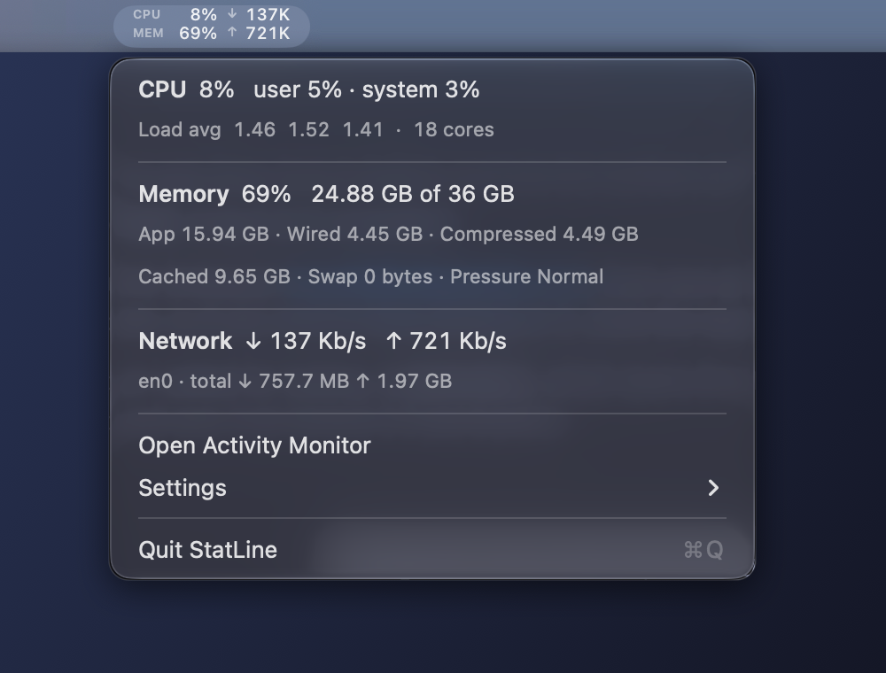

# StatLine

A tiny macOS menu bar app that shows CPU, RAM and network in **one** compact two-row item
(~90pt wide, or ~39pt in "Mini Bars" style), instead of three separate items.

<p align="center"></p>

```
CPU   7%  ↓ 131K
MEM  70%  ↑ 811K
```

Click it for details (CPU user/system, load average, memory breakdown, swap, pressure,
network interface and totals) plus settings: style, memory formula, network units
(bits/bytes), refresh interval, and Launch at Login.

**Refresh** defaults to every 5 seconds. Pick 1s, 2s, 5s or 10s, or choose **Custom…** to
enter any interval from 0.5 to 3600 seconds. Network speeds are averaged over the interval.

## Launch at Login

On first launch from an Applications folder, StatLine asks whether to open at login. Your answer
is remembered, and you can change it anytime in **Settings → Launch at Login**. If macOS needs
approval, StatLine offers to open System Settings → General → Login Items.

From the terminal (use the binary inside the installed app):

```sh
~/Applications/StatLine.app/Contents/MacOS/StatLine --login-item status   # or: on / off
```

## Build & install

Requires the Xcode command line tools (Swift 5.9+), macOS 13+.

```sh
./build.sh            # builds build/StatLine.app
./build.sh --install  # copies to ~/Applications and launches it
```

`StatLine --sample` prints a few readings to the terminal.

## Notes

- Reads counters straight from the kernel (`host_statistics`, `host_statistics64`,
  `NET_RT_IFLIST2` 64-bit interface counters); no shelling out. Effectively 0% CPU.
- Network counts physical `en*` interfaces only, so VPN tunnels don't double count.
- "Memory Used" defaults to Activity Monitor's definition (App + Wired + Compressed).
  The alternative (Active + Wired + Compressed) reads lower and is closer to the Usage app.

## License

MIT. See [LICENSE](LICENSE).
